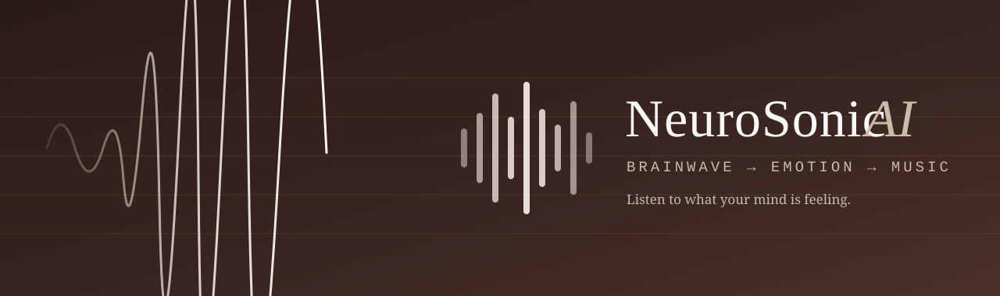
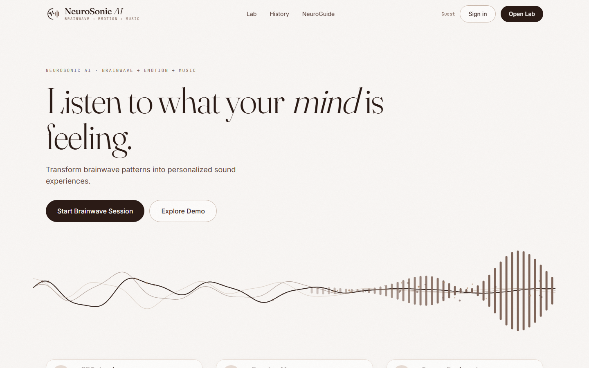
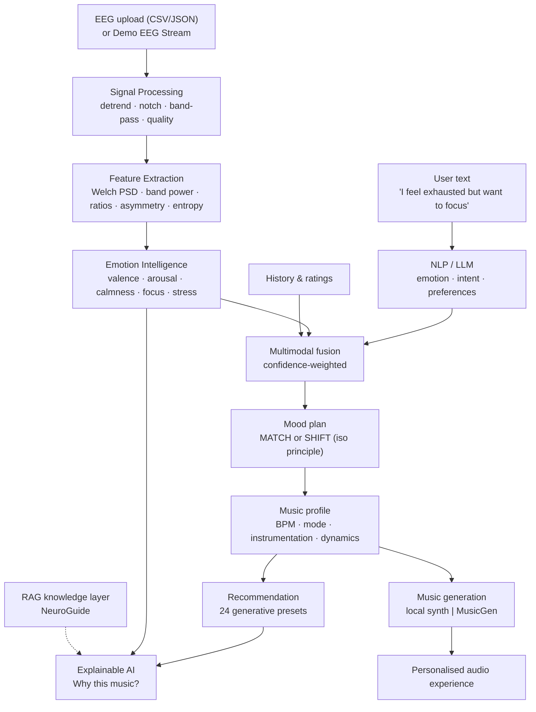
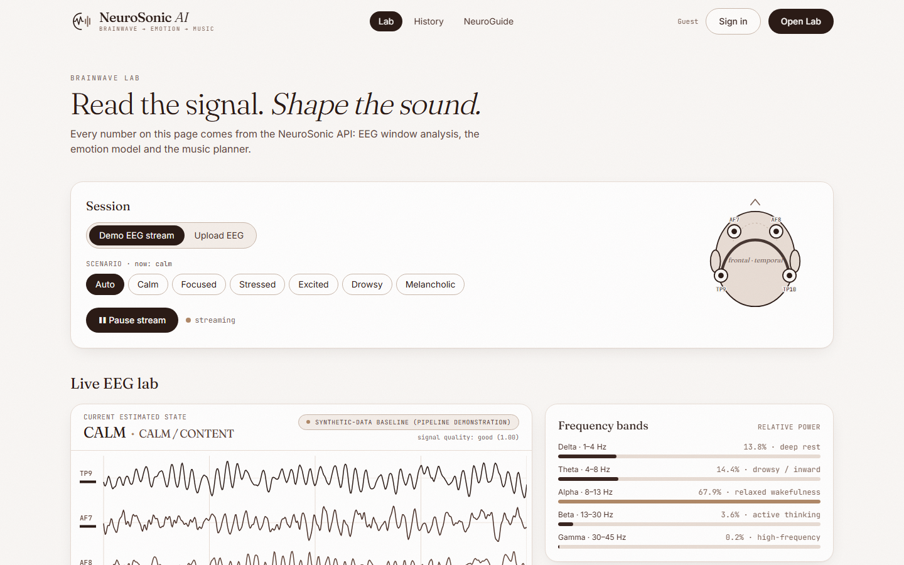
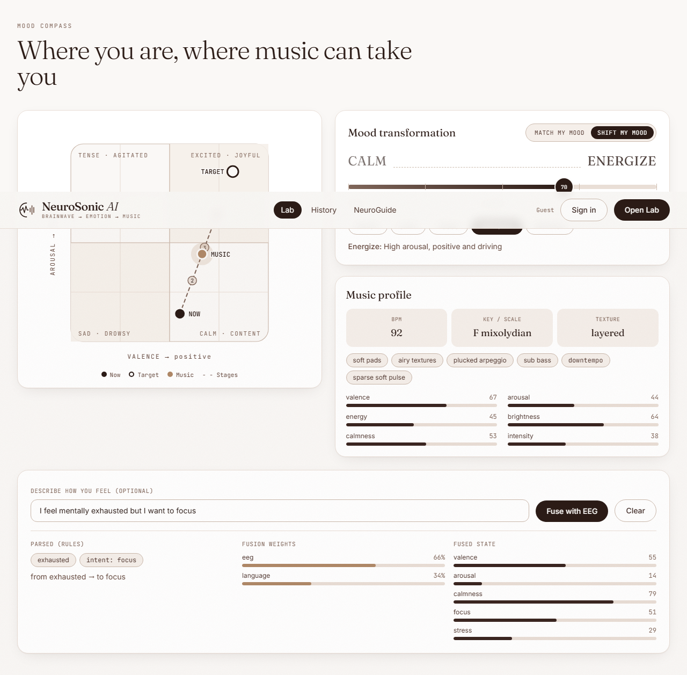
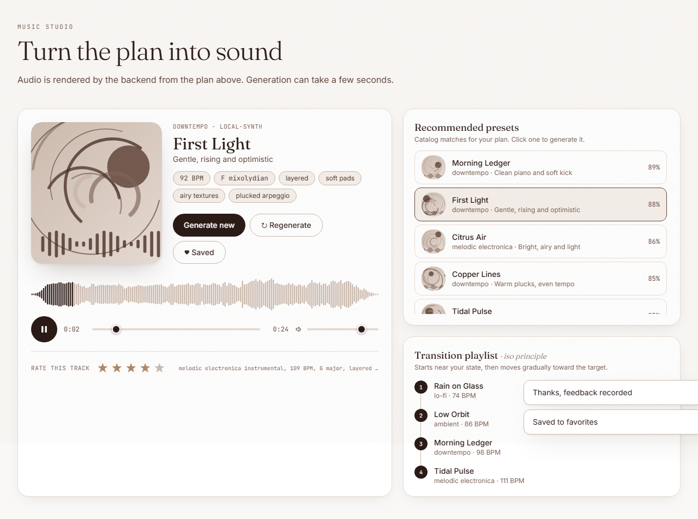
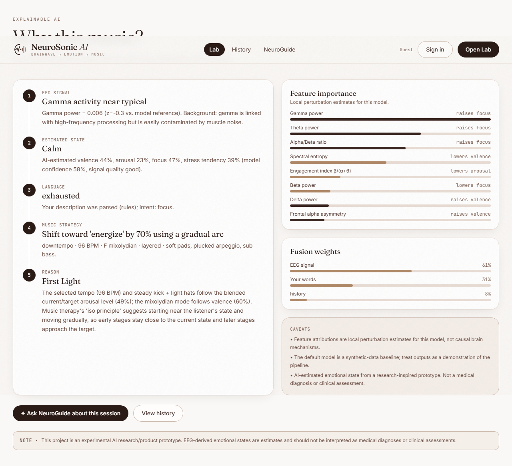
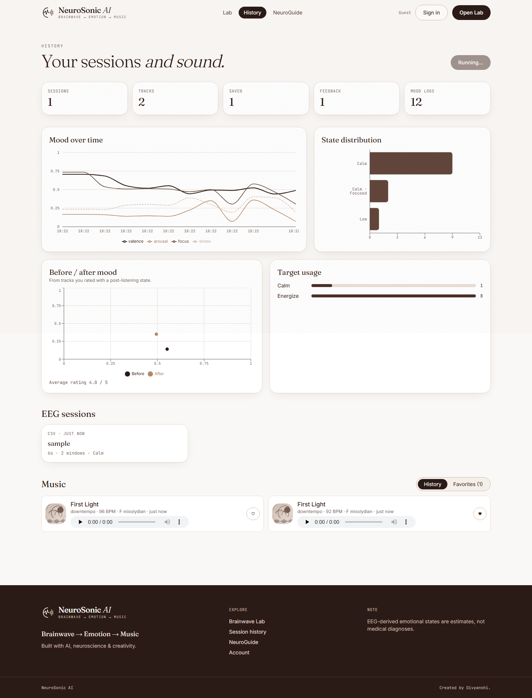
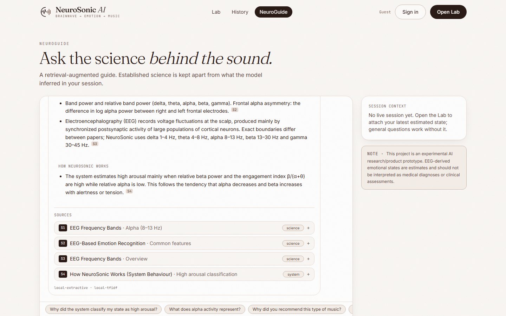

<div align="center">



# NeuroSonic AI

**Brainwave → Emotion → Music.** An experimental full-stack AI system that turns EEG-derived features into an AI-estimated emotional state, then generates music that matches, or gently shifts, that state.




</div>

> **Disclaimer.** This project is an experimental AI research/product prototype. EEG-derived emotional states are estimates and should not be interpreted as medical diagnoses or clinical assessments. See [Limitations](#limitations) and [Ethical considerations](#ethical-considerations).

--- 

## Overview

NeuroSonic ingests EEG (uploaded CSV/JSON, or a built-in **Demo EEG Stream** that needs no hardware), runs a real signal-processing pipeline, estimates five emotional dimensions with a machine-learning model, optionally fuses what you *say* about how you feel (NLP/LLM), and produces music as real audio: either mirroring your state (**Match my mood**) or moving you gradually toward a target (**Shift my mood**). Every recommendation comes with a *"Why this music?"* explanation and an evidence-grounded assistant (**NeuroGuide**, RAG) that separates established science from model inference.

## Why NeuroSonic?
- **An end-to-end AI product, not a notebook:** signal processing, ML, NLP, RAG, generative audio, auth, database, API, tests, Docker and a polished UI in one repo.
- **Scientifically honest:** the default model is labelled a synthetic-data baseline, confidence and signal quality are always shown, and no accuracy is claimed that was not measured.
- **Works instantly:** Demo Mode runs the full pipeline with no EEG device, no API keys and no downloads.

## Problem Statement
Music is one of the most common tools people use to regulate mood, yet playlists ignore the listener's *current* state, and neural signals are rarely connected to generative systems in an inspectable way.

## Solution
Close the loop: **measure** (EEG features) → **estimate** (emotion model) → **understand** (language + history) → **act** (music profile → audio) → **explain** (feature attributions + RAG), with every provider swappable and a local fallback for each.

## Key Features

| | Feature | What it does |
|---|---|---|
| 🧠 | **Live EEG Lab** | Scrolling 4-channel waveform, band powers, PSD, signal quality, live features and emotion estimate with confidence, all computed by the backend pipeline |
| 🧭 | **Mood Compass** | Valence × arousal plane showing current, target and music state with the staged trajectory |
| 🎚️ | **Mood transformation slider** | Drag from *current* toward *calm / focus / energize / refresh*; BPM, mode, instrumentation and playlist stages update live |
| 🎼 | **Music Studio** | Real generated audio (numpy synth or hosted MusicGen), waveform, player, save, regenerate, ratings |
| 💬 | **Language fusion** | "I feel mentally exhausted but I want to focus" is parsed (rules, optionally an LLM) and fused with EEG; fusion weights are shown |
| 🔎 | **Explainable AI** | EEG signal → state → strategy → reason chain, feature-importance bars, caveats |
| 📚 | **NeuroGuide (RAG)** | Chunked knowledge base, vector search, cited answers split into *science* vs *inference* |
| 📈 | **History & analytics** | Stored sessions, mood trends, favourites, before/after mood from feedback |
| 🔐 | **Auth & persistence** | JWT, bcrypt, PostgreSQL (SQLite for zero-setup dev), Alembic migrations |

## Architecture



More detail: [docs/architecture.md](docs/architecture.md).

## AI Pipeline

| Stage | Module | Detail |
|---|---|---|
| Ingest | `ml/eeg/io.py` | CSV/JSON validation, size/shape limits |
| Preprocess | `ml/eeg/preprocessing.py` | linear detrend, 50/60 Hz notch, 0.5–45 Hz zero-phase Butterworth, quality score |
| Features | `ml/eeg/features.py` | Welch PSD, absolute/relative band power, θ/β, α/β, β/(α+θ), frontal alpha asymmetry, spectral entropy, Hjorth, temporal stats |
| Emotion | `ml/emotion/model.py` | Random Forest regressor → 5 dimensions + confidence + local attributions |
| Fusion | `ml/music/mood.py` | EEG + language + history, weights reported |
| Music | `ml/music/{profile,recommend,synth}.py` | mood → profile → ranked presets → rendered audio |
| Language | `ml/nlp/` | affect lexicon + intent rules, optional OpenAI-compatible LLM |
| Knowledge | `ml/rag/` | chunking, TF-IDF (or sentence-transformers) embeddings, vector search |

## EEG Processing
Default montage: 4 channels (TP9, AF7, AF8, TP10) at 256 Hz; any channel names and 32–2048 Hz are accepted. Bands: δ 1–4, θ 4–8, α 8–13, β 13–30, γ 30–45 Hz. The Demo Stream is a simulator driven by a latent mental state (band oscillators, 1/f noise, frontal eye-blinks, valence-dependent frontal asymmetry) whose samples go through **exactly the same pipeline** as uploaded data. Details: [docs/eeg-pipeline.md](docs/eeg-pipeline.md).

## Emotion Model
A multi-output Random Forest estimates valence, arousal, calmness, focus and stress tendency from 13 mostly relative-power features. The shipped model is trained on **synthetic** EEG and is labelled so in the UI and API. A training script supports **DEAP** with subject-independent evaluation (`--loso`); DEAP is not bundled. Details: [docs/ai-models.md](docs/ai-models.md).

## NLP + LLM
A rule-based parser always works. With `LLM_API_KEY` set (any OpenAI-compatible endpoint), an LLM's JSON output is validated, clipped and merged with the rules; any failure falls back to rules.

## RAG Architecture
7 curated markdown documents → heading-aware chunks (41) → TF-IDF embeddings (swap-in: sentence-transformers) → cosine search with heading re-rank → LLM or extractive composer. Answers are split into **Established science**, **How NeuroSonic works** and **Model inference (this session)**, with `[S1]` citations. Details: [docs/rag.md](docs/rag.md).

## Music Generation
No copyrighted songs are used. A numpy synthesiser renders pads, bass, arpeggios, percussion and reverb from the music profile (BPM, mode, brightness, density, dynamics, timbre). SHIFT mode renders a multi-stage arc with cross-fades. A `MusicProvider` interface also supports hosted **MusicGen** (`HF_API_TOKEN`), falling back to the local synth automatically.

| Mood | Profile (example output) |
|---|---|
| Calm, low arousal | ambient, ~60–75 BPM, lydian/major, soft pads, no percussion, long reverb |
| Positive, high arousal | melodic electronica, ~120+ BPM, major, plucked arpeggio, kick + hats, bright lead |
| Stressed → *Calm* (SHIFT) | starts ~118 BPM minor/dark, ends ~69 BPM mixolydian ambient across 4 stages |

## Explainable AI
The *Why this music?* panel shows: **EEG signal** (e.g. "Beta activity elevated, z=+1.4") → **Estimated state** → **Music strategy** → **Reason**, plus local feature-attribution bars, fusion weights and caveats. Attributions describe the model, not brain mechanisms.

## Database Architecture
10 tables: `users`, `user_preferences`, `eeg_sessions`, `eeg_signals`, `emotion_predictions`, `mood_history`, `music_sessions`, `recommendations`, `generated_tracks`, `feedback`. Raw EEG samples are not stored. ER diagram in [docs/api.md](docs/api.md).

## API Documentation
27 REST endpoints; Swagger at `http://localhost:8000/docs`. Reference and examples: [docs/api.md](docs/api.md).

## Screenshots

| Live EEG Lab | Mood Compass + slider |
|---|---|
|  |  |
| **Music Studio** | **Why this music?** |
|  |  |
| **History & trends** | **NeuroGuide** |
|  |  |

## Demo
Hosted demo: _not deployed yet_ — run it locally in two minutes (below). Try the **Demo EEG Stream** in `/lab`, pick a scenario, drag the mood slider, press *Generate*.

## Installation

**Requirements:** Python 3.12+, Node 20+ (Docker optional).

### Local development (SQLite, no Docker)
```bash
git clone <your-repo-url> neurosonic-ai && cd neurosonic-ai
pip install -r backend/requirements-dev.txt

# backend  (http://localhost:8000/docs)
export PYTHONPATH=ml                      # PowerShell: $env:PYTHONPATH="ml"
python -m uvicorn app.main:app --app-dir backend --reload

# frontend (http://localhost:5173)
cd frontend && npm install && npm run dev
```
Or run `scripts/dev.sh` / `scripts/dev.ps1` to start both.

### Docker Setup
```bash
cp .env.example .env     # set SECRET_KEY
docker compose up --build
```
| Service | URL | Notes |
|---|---|---|
| frontend | http://localhost:8080 | nginx, proxies `/api` |
| backend | http://localhost:8000 | runs `alembic upgrade head` on start |
| db | internal | PostgreSQL 16, volume `pgdata` |

> The Docker setup has not been executed by the author in the original dev environment (no Docker there); the SQLite local flow and the test-suite have. Please open an issue if `docker compose up` misbehaves.

### Environment Variables
See [.env.example](.env.example). Key ones: `SECRET_KEY`, `DATABASE_URL`, `CORS_ORIGINS`, `LLM_API_KEY` / `LLM_BASE_URL` / `LLM_MODEL` (optional), `HF_API_TOKEN` (optional MusicGen), `EMBEDDING_PROVIDER`, `MAX_UPLOAD_MB`, `NOTCH_HZ`. Without any key everything still works in Demo Mode.

### Model Setup
`models/emotion_rf.joblib` ships with the repo (synthetic baseline, scikit-learn 1.8.0). Retrain: `python scripts/train_emotion.py`.

### Dataset Setup
Request DEAP, extract `data_preprocessed_python/`, then `python scripts/train_emotion.py --dataset deap --path <dir> --loso`. Sample synthetic recordings for the upload flow: `data/sample/*.csv|json` (regenerate with `python scripts/make_sample_eeg.py`).

### API Usage
```bash
curl "localhost:8000/api/eeg/demo/window?scenario=stressed&t=4"            # EEG → features → emotion
curl -X POST localhost:8000/api/music/recommend -H "Content-Type: application/json" \
  -d '{"emotion":{"valence":0.25,"arousal":0.8,"calmness":0.15,"focus":0.4,"stress":0.85},"mode":"shift","target":"calm"}'
```

## Project Structure
```
neurosonic-ai/
├── frontend/        React + TS + Vite + Tailwind + Framer Motion + Recharts
├── backend/         FastAPI app (api/, core/, db/, services/), Alembic migrations
├── ml/neurosonic_ml EEG · emotion · music · nlp · rag (+ knowledge/*.md)
├── models/          emotion_rf.joblib + metadata
├── data/sample/     synthetic example recordings
├── scripts/         train_emotion.py, make_sample_eeg.py, dev.sh/.ps1
├── docs/            architecture, eeg-pipeline, ai-models, rag, api, deployment, research-notes
├── tests/           72 pytest tests
├── docker/          backend.Dockerfile
├── assets/          banner, screenshots
└── docker-compose.yml · .env.example · LICENSE
```

## Testing
```bash
python -m pytest -q          # 72 tests, ~25 s
cd frontend && npm run typecheck && npm run build
```
Covers: EEG filtering/PSD/feature extraction (injected sinusoids), file parsing and limits, emotion prediction and ordering, DEAP loader, mood→music mapping, SHIFT trajectories, fusion, recommendation personalisation, audio rendering, NLP, RAG retrieval and answer structure, all API endpoints (auth, ownership, uploads, errors) and database models/cascades.

## Security
bcrypt password hashing · JWT (HS256) · secrets only via environment (`.env` is git-ignored) · CORS allow-list · Pydantic validation · upload extension/size/shape checks (5 MB) · per-user ownership checks on sessions/tracks · generic 500 responses (details stay in logs) · non-root Docker user. Not included: rate limiting and email verification (see [deployment](docs/deployment.md)).

## Case study

| Stage | Summary |
|---|---|
| **Problem** | Music for mood regulation is blind to the listener's current state. |
| **Research** | Circumplex affect, EEG band tendencies, frontal asymmetry, music-emotion cues, iso principle ([notes](docs/research-notes.md)). |
| **Architecture** | Pure-Python ML package + thin FastAPI orchestration + React client; every AI component behind a provider interface with a local fallback. |
| **Data** | No real EEG is bundled. A latent-state simulator generates labelled synthetic EEG; DEAP loader provided for real data. |
| **Model** | Random Forest on 13 spectral/ratio features; confidence from tree agreement × signal quality. |
| **Evaluation** | Held-out split on synthetic data (reported in `/api/health`, e.g. arousal R² 0.96, valence 0.71, focus 0.40) shows the model inverts the simulator **only**; real-world accuracy is **unmeasured**. A subject-independent protocol (`--loso`) is provided. |
| **Product** | Live Lab, Mood Compass, SHIFT slider, Music Studio, Why-this-music, NeuroGuide, history. |
| **Results** | A working closed loop in Demo Mode; no clinical or outcome claims. |
| **Limitations** | See below. |
| **Future work** | See roadmap. |

## Limitations
- **Synthetic baseline:** the shipped model has never seen real brain data; its outputs demonstrate the pipeline.
- **EEG noise & artifacts:** blinks, muscle activity and electrode contact dominate scalp EEG; the quality score is heuristic, with no ICA.
- **Individual variability:** baselines and responses differ between people and days; there is no per-user calibration yet.
- **Emotion labels:** self-reported, subjective and noisy; "focus" and "stress" are not directly measurable by this model.
- **Dataset limitations & bias:** public datasets are small, lab-induced and demographically narrow; DEAP lacks real calm/focus/stress labels.
- **Hardware differences:** models rarely transfer across devices, montages and sampling rates.
- **Scientific uncertainty:** frontal asymmetry and band-ratio markers are debated; attributions describe the model, not neural causes.
- **Music effects:** presets follow perception research; they are not shown to change anyone's mood.

## Ethical Considerations
Neural data is sensitive: raw samples are not persisted, features can be limited to the model vector, and users can only access their own data. Outputs are worded as *AI-estimated*; the app makes no diagnostic, therapeutic or clinical claim and should not be used for medical decisions or to monitor others without consent.

## Future Roadmap
- [ ] Real-device streaming (BrainFlow / LSL / Muse) with per-user resting-baseline calibration
- [ ] Train and publish a subject-independent model on DEAP/SEED with honest LOSO metrics
- [ ] ICA/ASR artifact removal; MNE interoperability
- [ ] Dense embeddings + reranker for NeuroGuide; streaming LLM answers
- [ ] Neural/transformer music generation with real-time adaptation
- [ ] A/B listening study using the built-in before/after feedback
- [ ] Rate limiting, OAuth, hosted demo

## Research Inspiration
Circumplex model of affect (Russell) · DEAP (Koelstra et al.) and SEED (Zheng & Lu) · frontal alpha asymmetry (Davidson) · engagement index (Pope et al.) · Welch's method · music and emotion (Juslin & Laukka) · music-listening regulation (Saarikallio) · iso principle in music therapy. See [docs/research-notes.md](docs/research-notes.md).

## Tech Stack
**Frontend** React 18, TypeScript, Vite, Tailwind CSS, Framer Motion, Recharts, Canvas/SVG · **Backend** Python, FastAPI, Pydantic v2, SQLAlchemy 2, Alembic, PostgreSQL, JWT/bcrypt · **ML** NumPy, SciPy, pandas, scikit-learn · **NLP/RAG** rule-based NLP, OpenAI-compatible LLM (optional), TF-IDF / sentence-transformers · **Music** numpy synthesis, Hugging Face MusicGen (optional) · **Ops** Docker Compose, nginx, pytest

## Author
**Divyanshi** — built with curiosity, code & AI.

---

<div align="center">

```
━━━━━━━━━━━━━━━━━━━━━━━━━━━━━━━━━━━━━━━━━━━━
```


### 🧠 NEUROSONIC AI
**BRAINWAVE → EMOTION → MUSIC**

*Created by* **Divyanshi**

```
━━━━━━━━━━━━━━━━━━━━━━━━━━━━━━━━━━━━━━━━━━━
```

**Created with curiosity, code & AI by Divyanshi.**

</div>
