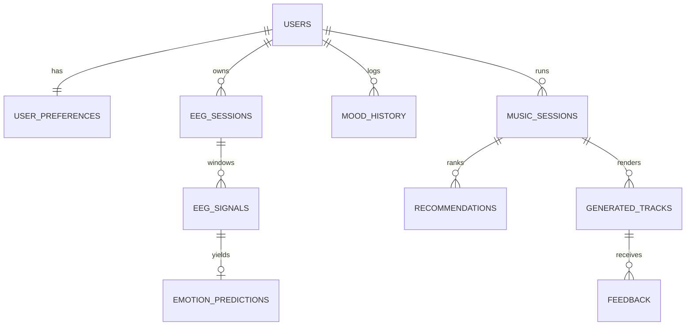

# API

Interactive docs: `http://localhost:8000/docs` (Swagger) and `/redoc`. Errors are `{"detail": ...}`; validation errors are
`{"detail":"Invalid request","errors":[{"field","message"}]}`. Auth is `Authorization: Bearer <JWT>`.
Request/response models live in `backend/app/schemas.py`.

| Method | Path | Auth | Purpose |
|---|---|---|---|
| POST | /api/auth/register, /login | - | Account + JWT |
| POST | /api/auth/demo | - | One-click guest account |
| GET | /api/eeg/demo/window | - | Synthetic EEG window through the full pipeline |
| POST | /api/eeg/analyze | - | Analyse raw samples `{fs, samples:{ch:[..]}}` |
| POST | /api/eeg/session | yes | Record and store a demo session |
| POST | /api/eeg/upload | yes | CSV/JSON upload, stored as a session (<= 5 MB) |
| GET | /api/eeg/sessions, /api/eeg/session/{id} | yes | List / detail (own sessions only) |
| POST | /api/emotion/predict | - | Emotion from a feature vector |
| GET | /api/mood/history | yes | Mood log |
| POST | /api/nlp/parse | - | Language to emotions / intent / preferences |
| POST | /api/music/recommend | optional | Fusion, plan, profile, ranked presets, explanation |
| POST | /api/music/generate | optional | Recommend + render audio (cached, content-addressed) |
| GET | /api/music/audio/{id}.wav | - | Audio file |
| GET | /api/music/catalog, /targets | - | Presets, SHIFT targets |
| POST | /api/music/save, /feedback | yes | Favourite; rating + optional mood-after |
| GET | /api/music/history | yes | Generated tracks (`saved_only`) |
| GET/PUT | /api/user/profile, /preferences; GET /analytics | yes | Profile, preferences, trends |
| POST | /api/guide/chat; GET /api/guide/suggestions | - | NeuroGuide RAG chat |
| GET | /api/health, /api/meta | - | Status, model info, counts |

## Example
```bash
TOKEN=$(curl -s -X POST localhost:8000/api/auth/demo | python -c "import sys,json;print(json.load(sys.stdin)['access_token'])")
curl -s "localhost:8000/api/eeg/demo/window?scenario=stressed&t=4" > window.json
curl -s -X POST localhost:8000/api/music/generate -H "Authorization: Bearer $TOKEN" -H "Content-Type: application/json" -d '{
  "emotion": {"valence":0.25,"arousal":0.8,"calmness":0.15,"focus":0.4,"stress":0.85,"confidence":0.7},
  "mode":"shift","target":"calm","shift":1.0,"text":"I feel overwhelmed, lofi piano please","duration_s":24}'
```

## Database (10 tables)
`users`, `user_preferences`, `eeg_sessions`, `eeg_signals` (per-window features), `emotion_predictions`, `mood_history`,
`music_sessions`, `recommendations`, `generated_tracks`, `feedback`. Foreign keys cascade on delete; indexes on user_id, created_at,
(user_id, ts) and `generated_tracks.saved`. Migration: `backend/alembic/versions/0001_initial_schema.py`.


