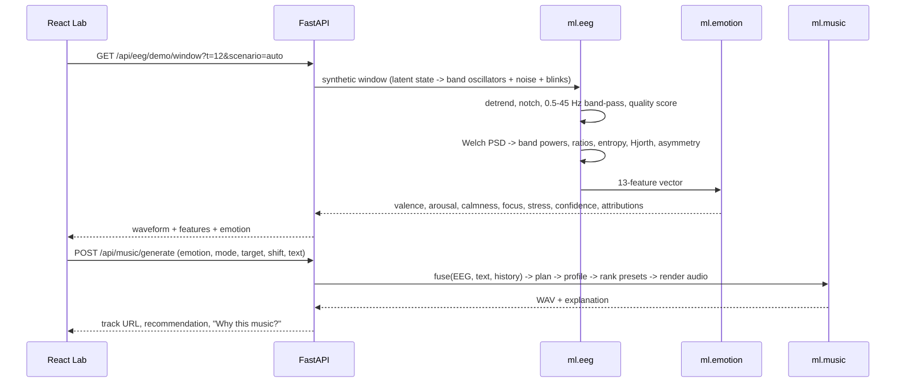

# Architecture

NeuroSonic is three deployable units and one shared Python package.

```
frontend/   React + TS + Vite (nginx in Docker)         -> calls /api
backend/    FastAPI, SQLAlchemy 2, Alembic, JWT          -> orchestration, persistence, HTTP
ml/         neurosonic_ml (numpy / scipy / sklearn)      -> EEG, emotion, music, NLP, RAG
models/     emotion_rf.joblib (+ .meta.json)             -> baseline model artefact
db          PostgreSQL 16 (SQLite for zero-setup dev)
```

## Why `ml/` is a separate package
The scientific code has no web or database dependency. It is unit-tested on its own and reusable from notebooks and
training scripts; the backend is a thin orchestration layer (`backend/app/services/engine.py`).

## Request flow (Demo Mode)


The demo stream is **not** a separate code path: synthetic samples go through exactly the same `analyze_window`
function as uploaded CSV/JSON recordings and `POST /api/eeg/analyze`.

## Provider interfaces (swap without rewriting the app)
| Interface | Location | Shipped implementations |
|---|---|---|
| `EmotionModel` | `ml/emotion/model.py` | `RandomForestEmotionModel` (synthetic baseline; DEAP-trainable) |
| `LLMProvider` | `ml/nlp/llm.py` | `OpenAICompatibleProvider`, `LocalFallbackProvider` (rules / extractive) |
| `EmbeddingProvider` | `ml/rag/engine.py` | `TfidfEmbedder` (local), `SentenceTransformerEmbedder` (optional) |
| `MusicProvider` | `ml/music/providers.py` | `LocalSynthProvider` (numpy), `HuggingFaceMusicGenProvider` (needs token) |

Every optional provider degrades to a local implementation, and the API reports which one was used
(`provider_note`, `ChatOut.provider`, `/api/health`).

## Persistence
Raw EEG samples are **never stored**; only per-window features, predictions and mood history are kept
(`UserPreference.store_features=false` keeps only the model input vector). Tables are listed in [api.md](api.md).

## Key design decisions
- **Stateless demo stream** keyed by absolute time `t` and a seed, so any client can poll it and oscillator phase stays continuous.
- **Optional auth** on recommend/generate so the product works instantly; a one-click guest account (`POST /api/auth/demo`) enables history without sign-up.
- **Content-addressed audio**: files are named by a hash of (stages, duration, seed, provider), giving free caching and idempotent regeneration.
- **SQLite for dev, PostgreSQL for deployment** through one `DATABASE_URL`; JSON columns use `JSONB` on PostgreSQL.
